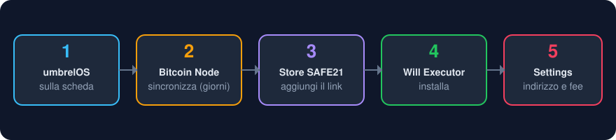
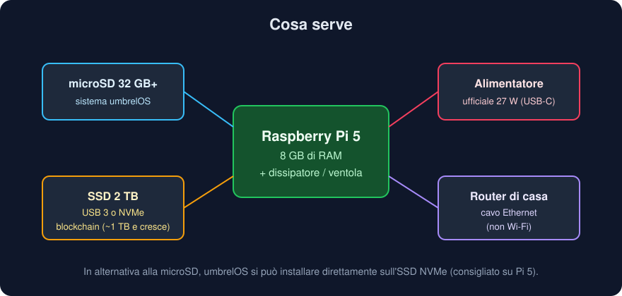
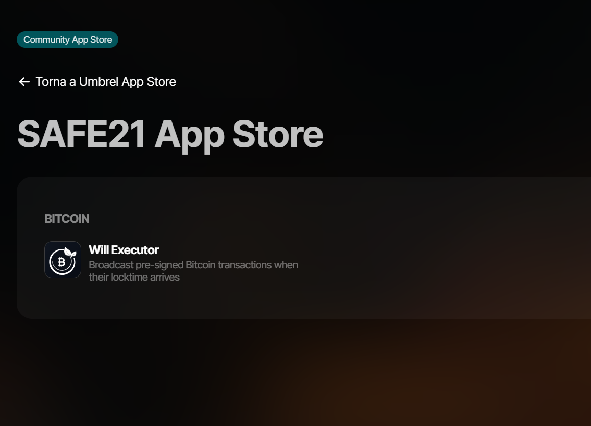
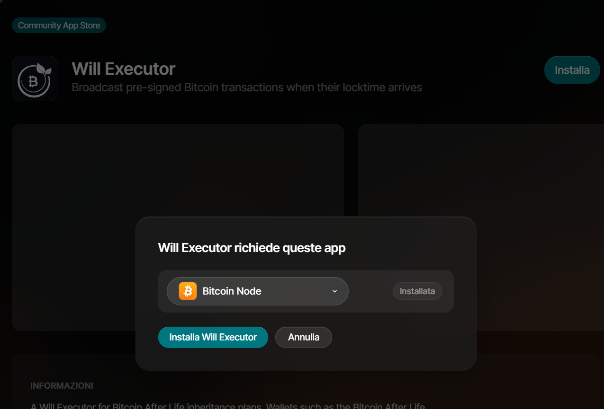
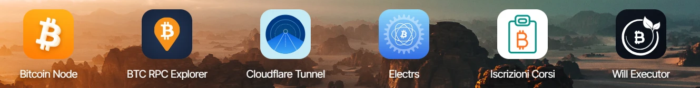
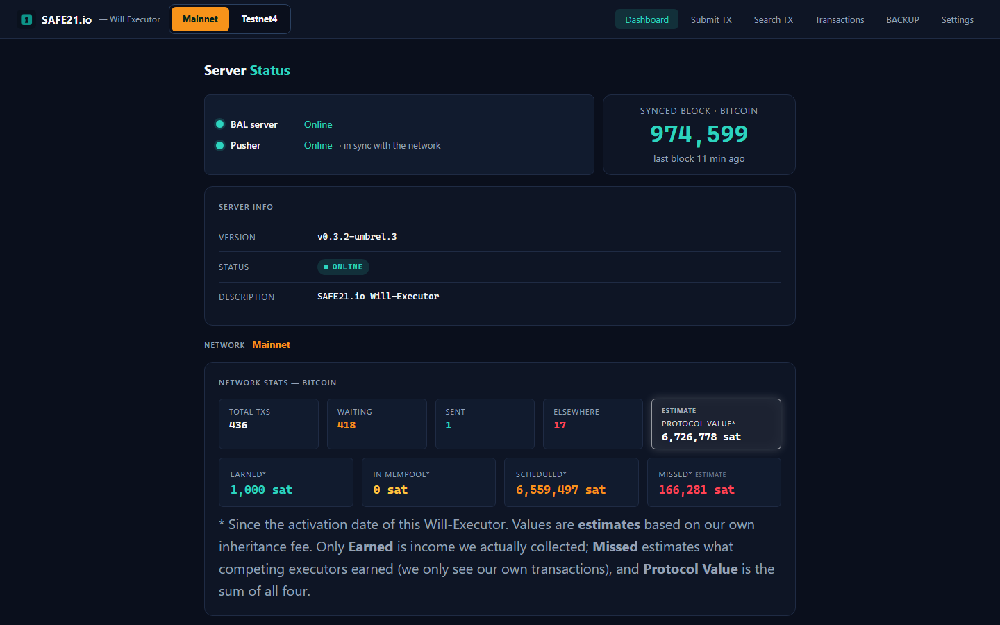
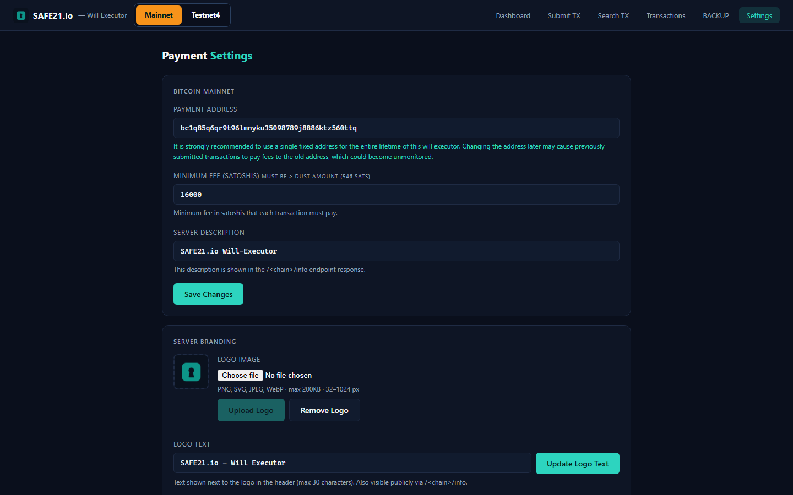

# Will Executor su Raspberry Pi — guida passo passo

Questa guida spiega come trasformare un Raspberry Pi in un **Will Executor** di
Bitcoin After Life: un piccolo server che custodisce transazioni Bitcoin già
firmate e bloccate nel tempo (i "testamenti" creati con il plugin Bitcoin After
Life per Electrum) e le trasmette alla rete quando arriva la loro scadenza.

Il server **non tiene mai chiavi private**: conserva solo transazioni firmate e
le rilascia al momento giusto, attraverso il **tuo** nodo Bitcoin.



---

## 1. Cosa serve



| Componente | Consiglio | Perché |
|---|---|---|
| **Raspberry Pi 5** | 8 GB di RAM | Il Pi 4 è supportato da umbrelOS ma è molto più lento a sincronizzare la blockchain. |
| **Disco SSD** | **2 TB**, USB 3 oppure NVMe (con una scheda HAT NVMe) | La blockchain completa con l'indice delle transazioni occupa oggi circa **1 TB** e cresce ogni anno. |
| **microSD** | 32 GB o più | Ospita umbrelOS. Su Pi 5 si può saltare e installare tutto sull'SSD NVMe. |
| **Alimentatore** | quello **ufficiale** Raspberry Pi (27 W per il Pi 5) | Alimentatori più deboli causano blocchi e corruzione dei dati, soprattutto con un SSD USB. |
| **Raffreddamento** | dissipatore con ventola (es. Active Cooler) | La sincronizzazione tiene la CPU sotto sforzo per giorni. |
| **Cavo Ethernet** | collegato al router di casa | Il primo avvio e l'accesso a `umbrel.local` funzionano via cavo. |

Il Will Executor in sé è leggerissimo (circa **30 MB di RAM** e una frazione di
CPU): quasi tutte le risorse servono al nodo Bitcoin.

---

## 2. Installare umbrelOS

Le istruzioni ufficiali sono su
[umbrel.com — Installing umbrelOS on Raspberry Pi](https://umbrel.com/support/install-umbrelos-on-your-own-hardware/installing-umbrelos-on-raspberry-pi).
In breve:

1. Scarica l'immagine per Raspberry Pi:
   <https://download.umbrel.com/release/latest/umbrelos-pi.img.zip>
   (la stessa per Pi 5 e Pi 4).
2. Installa [Raspberry Pi Imager](https://www.raspberrypi.com/software/) o
   [balenaEtcher](https://etcher.balena.io/) sul computer.
3. Inserisci la microSD nel computer, apri il programma, scegli l'immagine
   (in Raspberry Pi Imager: *Scegli SO → Usa personalizzato*) e la scheda,
   poi **Scrivi**.
   > ⚠️ Controlla due volte di aver scelto la scheda giusta: il contenuto viene
   > cancellato.
4. Espelli la scheda e inseriscila nel Raspberry Pi.
5. Collega il cavo Ethernet al router, l'SSD a una **porta USB 3 (blu)**, e per
   ultimo l'alimentatore.
6. Aspetta qualche minuto per il primo avvio.

> **Pi 4:** molti Pi 4 hanno bisogno di un aggiornamento del bootloader prima di
> avviare umbrelOS; la guida ufficiale qui sopra spiega come farlo.
>
> **Installazione su NVMe (Pi 5):** si scrive l'immagine direttamente sull'SSD
> NVMe con un adattatore USB, e si toglie la microSD dal Pi, altrimenti avvia
> da quella.

---

## 3. Primo accesso

Da un computer sulla stessa rete apri **<http://umbrel.local>** nel browser e
crea il tuo account (nome e password). Se l'indirizzo non risponde, cerca
l'indirizzo IP del Raspberry Pi nella pagina del router e usa
`http://<indirizzo-ip>`.

Se il disco SSD non è ancora usato da umbrelOS, segui le indicazioni sullo
schermo per usarlo come archivio principale.

---

## 4. Installare il nodo Bitcoin

1. Apri l'**App Store** di Umbrel e installa **Bitcoin Node**.
2. Aprilo: comincia a scaricare e verificare tutta la blockchain.
   Su un Raspberry Pi 5 con SSD servono in genere **alcuni giorni**.
   Puoi proseguire con la guida intanto, ma il Will Executor sarà pronto solo
   quando il nodo è sincronizzato al 100%.
3. Nelle impostazioni di Bitcoin Node controlla che:
   - **il pruning sia disattivato** (nodo completo);
   - **l'indice delle transazioni (`txindex`) sia attivo.**

   Il Will Executor usa l'indice per verificare se le transazioni trasmesse
   sono state confermate. Con un nodo "pruned" o senza indice, le transazioni
   confermate verrebbero segnate per errore come "completate altrove".
   Attivare l'indice dopo la sincronizzazione richiede qualche ora di
   ricostruzione.

---

## 5. Aggiungere lo store SAFE21

Il Will Executor non è nello store ufficiale di Umbrel, ma in uno **store
della community**. Si aggiunge una volta sola:

1. Apri l'**App Store** di Umbrel.
2. Clicca il pulsante **⋯** in alto a destra e scegli **Community App Stores**.
3. Incolla questo indirizzo e clicca **Add**:

   ```
   https://github.com/ManX-SAFE21/safe21-umbrel-apps
   ```

4. Clicca **Open** accanto allo store: si apre lo **SAFE21 App Store**.



---

## 6. Installare il Will Executor

1. Clicca **Will Executor**, poi **Installa**.
2. Umbrel mostra che l'app richiede **Bitcoin Node** (già installato al
   passo 4). Conferma con **Installa Will Executor**.

   

3. Dopo un paio di minuti l'icona compare nella schermata principale.
   Umbrel scarica da solo la versione per Raspberry Pi (arm64).

   

---

## 7. Configurare indirizzo e commissione

Apri l'app dalla home: la dashboard è protetta dal login di Umbrel.



Finché non imposti un indirizzo di pagamento la dashboard mostra
*"No networks enabled"*: è normale.

1. Vai su **Settings**.
2. Inserisci l'**indirizzo Bitcoin** su cui ricevere le commissioni.
   Usa un indirizzo fisso per tutta la vita del server: chi ti affida un
   testamento paga la commissione a quell'indirizzo, anche anni dopo.
3. Imposta la **commissione minima** in satoshi (deve superare 546 sat).
4. Facoltativo: una descrizione e il logo del tuo servizio.
5. **Save Changes**, conferma, poi premi **Restart server now** che compare
   sotto: il server si riavvia in pochi secondi e legge le nuove impostazioni.



Ora il server accetta transazioni sulla mainnet e le trasmetterà alla loro
scadenza.

---

## 8. Facoltativo: testnet4

Per fare prove senza bitcoin veri, dallo stesso store SAFE21 si può installare
**Will Executor Testnet4**. Aggiunge un secondo nodo Bitcoin, sulla rete di
prova testnet4, e lo collega al Will Executor: la dashboard resta una sola, con
un pulsante in più per la testnet4.

- Il nodo testnet4 occupa qualche decina di GB e fino a 2 GB di RAM: su un
  Raspberry Pi installalo solo se ti serve davvero.
- La prima sincronizzazione richiede qualche ora; le transazioni testnet4
  vengono controllate solo quando il nodo è sincronizzato.
- Indirizzo e commissione per la testnet4 si impostano in **Settings**, nella
  scheda **Testnet4** che compare dopo l'installazione (indirizzo `tb1…`),
  poi **Restart server now**.

---

## 9. Facoltativo: renderlo pubblico e comparire sulla welist

Per uso personale o familiare il server funziona già così, dalla rete di casa.
Per offrirlo ad altri serve un **indirizzo pubblico https**; il modo più
semplice è un **tunnel Cloudflare** (app *Cloudflare Tunnel* dallo store
ufficiale di Umbrel, con un tuo dominio). Il servizio da indicare nel tunnel
è:

```
http://safe21-will-executor_ui_1:80
```

Sul dominio pubblico le funzioni di amministrazione (impostazioni, backup,
ripristino) sono **sempre bloccate**: si usano solo da casa, dietro il login.

Per comparire sulla [welist di Bitcoin After Life](https://welist.bitcoin-after.life),
collegati al Raspberry Pi da un terminale:

```bash
ssh umbrel@umbrel.local
```

crea il file delle opzioni (la password è quella di Umbrel):

```bash
sudo nano /home/umbrel/umbrel/app-data/safe21-will-executor/data/app.env
```

scrivi queste due righe con il tuo dominio, salva (Ctrl+O, Invio, Ctrl+X):

```
BAL_SEND_STATS=true
BAL_PUBLIC_URL=https://il-tuo-dominio.example
```

e riavvia l'app dalla home di Umbrel.

---

## 10. Da sapere

- **Backup:** l'app fa da sola un backup settimanale del database (sezione
  **BACKUP**, ne conserva 12). Scaricane ogni tanto una copia anche fuori dal
  Raspberry Pi.
- **Non disinstallare l'app** senza aver prima scaricato un backup:
  disinstallando, Umbrel cancella anche i dati (transazioni affidate e chiave
  del server). Gli **aggiornamenti** invece conservano tutto.
- **Corrente:** il Raspberry Pi deve restare acceso. Se resta spento a lungo,
  alla riaccensione il server trasmette subito le transazioni scadute nel
  frattempo.
- **Aggiornamenti:** quando esce una nuova versione, Umbrel mostra il
  pulsante *Aggiorna* nell'App Store.

---

*SAFE21 — Will Executor per Bitcoin After Life.*
